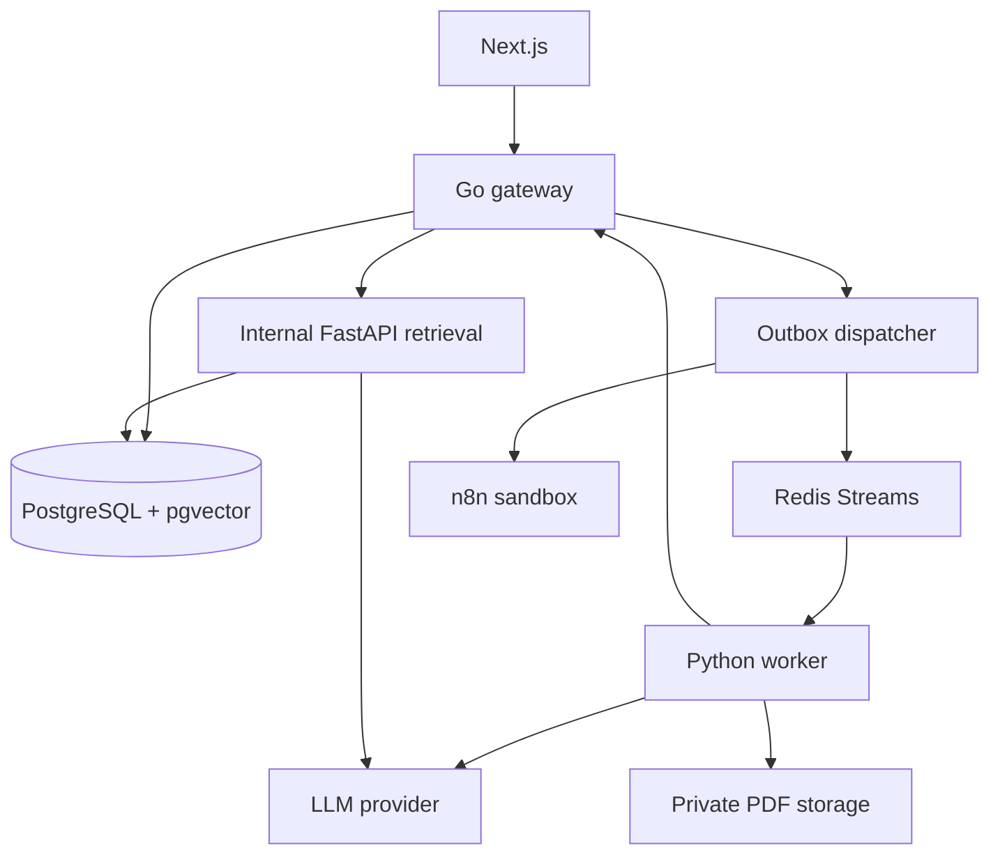

# Architecture
Status: proposed; repository and runtime not yet inspected. PROJECT_SPEC.md defines product scope. DECISIONS.md records approved changes; keep this document synchronized with implemented reality.

## Boundaries
- Next.js/TypeScript/Tailwind UI: sample selector, invoice preview, review, policy Q&A, evaluation. No provider keys or financial authority. Prefer separate app with portfolio link; inspect actual portfolio before integrating.
- Go/chi/pgx gateway: public API, session isolation, authorization, invoice revisions, decimal validation, state machine, audit, quotas, outbox and internal completion API.
- Python/FastAPI: internal extraction/retrieval endpoints; separate Redis Streams worker using same package. Pydantic, PyMuPDF, provider adapters; read-only scoped policy retrieval. Never write invoice state directly.
- PostgreSQL/pgvector: authoritative state, versioned migrations, policy chunks and full-text index. Redis: queue and TTL rate limits, not authoritative business state. Private object storage; local volume for fixtures. n8n optional sandbox notification adapter.

## Processing and consistency
Create invoice/job/outbox atomically. Dispatcher publishes stable job ID; duplicate delivery expected. Worker claims attempt, extracts structured data, sends authenticated completion; gateway validates and commits revision, state, audit and notification outbox atomically. ACK only after durable completion. Reclaim stale jobs; bounded concurrency 2, provider timeout 60s, job timeout 120s, max 3 attempts with backoff/jitter; dead-letter and reconcile stuck jobs. Use attempt fencing and unique completion constraints. No exactly-once claims. See API_CONTRACTS.md for proposed claim contract.

States: QUEUED -> PROCESSING -> READY_FOR_APPROVAL / PENDING_REVIEW / FAILED. FAILED -> QUEUED on authorized retry. Review states -> APPROVED / REJECTED by human; terminal thereafter. Corrections create revisions, rerun validation and require optimistic version. AED 10,000 threshold is fictional company policy. Standard-rate AED VAT arithmetic only; decimal strings, 0.01 tolerance, 15 ASCII digit TRN format only. Unsupported cases require review.

## RAG
Three fictional versioned policies; page/clause chunks, embeddings and keyword search, scoped retrieval, reciprocal rank fusion, top five context chunks. Resolve citations server-side; abstain on insufficient evidence or invalid citations. Treat documents as untrusted. No model-triggered actions.

## Security and operations
Sample-only anonymous isolated sessions, 24h expiry; HttpOnly Secure SameSite=Lax cookies in production, CSRF and explicit CORS. Prefer same-origin proxy. Private service network; service authentication; no raw documents/secrets in logs. Rate limits 10 AI calls/session/hour, 30/IP/hour plus global spend cap. Public demo cannot send real notifications or accept arbitrary uploads. Append-only audit permissions, not tamper-proof. Docker Compose local; Vercel UI and private container services plus persistent managed stores proposed, not provisioned. CI tests/build/lint/migrations/secret scan. Measure actual latency, token use and cost; separate mock and real metrics.

## Release gates
Foundation -> invoice vertical slice -> RAG -> review UI/telemetry -> evaluation/release. If schedule slips, release invoice-only scope after security gates, explicitly label missing modules. Do not claim deployment until verified. Update this file when actual topology, dependencies or ownership change.
