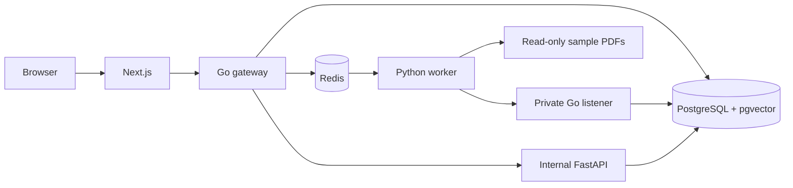

# NexusAI local architecture

The local MVP uses a mock provider, fictional documents and simulated human decisions. PostgreSQL owns business state. Redis Streams decouples submission from processing. The separate portfolio uses the Next.js App Router. See the [decision register](DECISIONS.md) for trade-offs and the [API contracts](API_CONTRACTS.md) for the implemented interfaces.

## Service boundaries

| Service | Responsibility |
|---|---|
| Next.js, TypeScript, Tailwind | Six responsive views, scoped PDF previews, review forms, citations, evaluation and metrics. Same-origin proxy for the public API. |
| Go, Chi, pgx | Cookie identity, origin and CSRF checks, quotas, deterministic validation, revisions, approval, audit, completion fencing and policy citation verification. |
| Python, FastAPI, PyMuPDF, Pydantic | Read printed sample labels and page evidence, validate mock output, and retrieve assigned policy clauses through a restricted read-only connection. A separate worker process shares the extraction library. |
| PostgreSQL 17 and pgvector | Expiring workspaces, invoices and durable job intent, versioned revisions, audit, mock runs, sandbox review notifications and hybrid policy index. |
| Redis 7.4 | Consumer groups and hourly quota keys with TTL. The database retains work awaiting delivery or recovery. |
| Migration and seed jobs | Advisory-locked checksummed SQL migrations and atomic policy indexing. Runtime database roles have explicit grants. |

## Invoice consistency

The gateway serializes short mutations within one workspace using a row lock. Submission atomically writes the invoice, job, first audit event, idempotency response and outbox intent. A stable job ID can be delivered more than once. The dispatcher republishes eligible queued or expired work until the database records a durable result. Two worker consumers reclaim abandoned stream entries. Extraction has a 60-second deadline and the gateway issues a 120-second fenced lease. Failed transient attempts use bounded exponential delay and jitter. Three failed attempts leave a queryable terminal failed job. Human retry creates a new job.

The completion transaction stores measured latency, revision, validation, state, audit and any sandbox notification together. A lost ACK and replay cannot create a second revision. The first revision retains the original evidence. Corrections increment the version, drop the changed field's original excerpt and revalidate. Rejection and overriding any issue require a reason. Approval and rejection are final. The gateway is the only owner of invoice writes.

The demo checks the simple single-rate AED case using decimal half-away-from-zero rounding to two places and an inclusive AED 0.01 tolerance. The supplier TRN check accepts exactly 15 ASCII digits. A total above AED 10,000 requires review under fictional company policy. Missing information, unsupported cases and inconsistent arithmetic route to review. Scanned samples retain an OCR_REQUIRED warning; OCR and Arabic extraction are deferred.

## Retrieval and telemetry

The seed indexes three versioned fictional handbooks by page and clause and hashes source content. Each workspace receives explicit assignments. The read-only service combines scoped cosine and full-text top-ten lists by reciprocal rank fusion and selects at most five contexts. A deterministic hash-vector adapter and conservative lexical support check select a single quotation or abstain. The gateway checks the ID, workspace and complete quote before releasing citation metadata. No model-triggered tools or policy actions exist.

Operation latency comes from a monotonic timer. The dashboard reports workspace counts and mean latency. The benchmark separately measures end-to-end invoice processing, enqueue HTTP and policy HTTP latency. Token, real model and price data are unavailable in mock mode.

## Security and release boundary

Only Next.js and the public gateway publish loopback ports. Database, Redis, worker, AI API and the private job listener are internal. Anonymous workspaces use a 256-bit opaque cookie secret stored as a digest and expire after 24 hours. HTTPS origins set Secure cookies. Mutations require exact origin verification and an HMAC-derived CSRF token. Queries scope user-controlled IDs. A periodic purge cascades expired workspace records. Application roles can insert and read audit records; database administrators control retention.

Redis atomically reserves a maximum of ten admissions per workspace and thirty per immediate peer per hour across invoice and policy operations. Submitting again with the same committed idempotency key consumes no extra admission. Failed reservations or processing can conservatively consume allowance. The web proxy currently shares a peer limit across its visitors. The only enabled provider is local mock, so provider spend is bounded at zero. A paid adapter would require explicit authorization, configuration, budget reservation and separate evaluation.

The project has no external deployment, payment path or notification destination. Local sandbox rows record pending-review notifications. The optional n8n sandbox runs on an internal-only network. A notification outbox row is committed with each pending revision. A separate dispatcher signs the metadata and retries failed deliveries three times. The default local receiver and the n8n workflow both use the same HMAC-verified, five-minute-window, idempotent receipt handler. The workflow has no invoice decision privilege. Private uploads, OIDC, OCR and production hosting remain separate work. The benchmark Compose project uses independent temporary stores and no published ports.

## M1 extension

Migration 007 adds durable tenant ownership, named local sign-in, membership roles, scoped database access and attributable decisions. The preceding sections describe the original demo. Session cleanup now removes access while retaining history, and only demo tenants produce sandbox notifications. [Current architecture](docs/ARCHITECTURE.md) · [Security model](docs/SECURITY.md)
