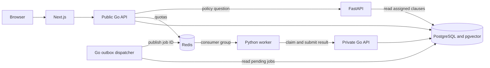

# Nexus AI architecture and invoice walkthrough

This audit covers commit `dc8a58d` on 25 November 2026. Nexus AI runs a sample accounts-payable workflow locally. Go owns the invoice and its decisions, Python reads the document, and Next.js shows a reviewer the source, checks and history. The AWS design below is proposed. [Local architecture record](../ARCHITECTURE.md) · [Audit evidence](PROGRESS.md)

## M1 implementation · 25 November 2026

The walkthrough below traces the original anonymous demo. At `/organization`, a one-time sign-in establishes a durable company context. Next.js shows the user, organization and role. A named REVIEWER can submit a sample, inspect the same PDF and financial checks, correct it and approve when clean. The API checks the active membership inside the write transaction. PostgreSQL stores the authenticated actor, tenant, ruleset and invoice revision with the decision. Sign-out and demo cleanup leave company invoices and audit rows intact.

Migration 007 preserves existing IDs and moves business ownership to tenants. Jobs can now run independently of a browser session. Go sets transaction-local scope for the request role, and Python sets it in its policy-reader transaction. Customer input remains limited to the same fictional catalog in M1. The diagram and migration table below document the audited `dc8a58d` baseline. [Tenant schema](../migrations/007_tenant_identity.sql) · [Revision-author constraints](../migrations/008_identity_constraints.sql) · [Security and operations](SECURITY.md)

## Follow one invoice

1. Open **Invoice auditor** and select **Design services**. The browser starts or resumes a demo workspace. Its cookie identifies the workspace, and a separate CSRF token accompanies changes. Preview reads a catalogued PDF through Go. All demo workspaces see the same five fictional source files. [Browser walkthrough](nexusai-demo.webm) · [Preview handler](../services/gateway/preview.go)
2. Press **Process invoice**. The browser sends a sample ID and an idempotency key. Go commits the invoice, job, first audit event, replay response and an outbox row together in PostgreSQL. An outbox row records work that still needs delivery. The browser receives HTTP 202 plus invoice and job IDs and can poll for progress. [Enqueue transaction](../services/gateway/invoices.go#L68)
3. Go's dispatcher publishes the job ID to Redis Streams. A Python worker asks Go's private listener for a claim. Go returns the sample ID, attempt number and a time-limited lease token. The worker reads the PDF through the shared Python extraction library and returns fields, page excerpts and warnings. Go checks the attempt and lease before accepting the result. [Dispatcher and claims](../services/gateway/jobs.go) · [Worker](../services/ai/app/worker.py)
4. The sample prints a subtotal of AED 480.00, a 5% rate, VAT of AED 20.00 and a total of AED 500.00. Python reads those printed values correctly. Go calculates expected VAT of AED 24.00 and flags the discrepancy. It saves a revision and routes the invoice to `PENDING_REVIEW`. A clean invoice reaches `READY_FOR_APPROVAL`. Both states require a person to decide. [Financial checks](../services/gateway/rules.go#L57) · [Revision transaction](../services/gateway/invoices.go#L310)
5. The reviewer can enter VAT of 24.00 and total of 504.00, explain the correction, and save. Go retains the earlier revision, removes the edited fields' old evidence from the new revision and reruns the checks. Approval or rejection then records a terminal state and audit event. A stale browser version receives HTTP 409. Approval here records a simulated decision. [Review handler](../services/gateway/invoices.go#L344) · [Browser acceptance scenario](../apps/web/tests/workspace.spec.ts)

The two Go listeners and dispatcher run in one process. FastAPI and the worker are separate processes built from one Python image. The worker calls the extractor directly. Policy questions take the synchronous FastAPI path. [Process wiring](../compose.yaml) · [Gateway startup](../services/gateway/main.go#L267)

## Code and HTTP boundaries

| Location | Responsibility today |
|---|---|
| [apps/web](../apps/web) | Next.js App Router, React, TypeScript, Tailwind, same-origin API proxy and typed client. Six views cover overview, invoice auditor, review queue, policy assistant, evaluation and architecture. |
| [services/gateway](../services/gateway) | Go with Chi, pgx, go-redis and decimal arithmetic. Owns session checks, quotas, submissions, jobs, validations, revisions, decisions, history, metrics and citation verification. |
| [services/ai](../services/ai) | FastAPI/Uvicorn, Pydantic, PyMuPDF, HTTPX, Redis client and psycopg. A provider interface, deterministic English label reader, evidence checks, worker, policy retrieval and seed command are implemented. Python dependencies have a uv lock. |
| [packages/contracts](../packages/contracts) | Three machine-readable OpenAPI documents. Public Go routes drive the TypeScript client. The web image also serves the public schema. |
| [migrations](../migrations), [infra](../infra), [Compose](../compose.yaml) | Database schema, migration runner, development services, optional n8n, isolated evaluation and integration overrides. |
| [fixtures](../fixtures), [evaluation](../evaluation), [scripts](../scripts) | Five demo PDFs, 20 evaluation PDFs, labels, policy catalog, policy questions, measured mock results, setup and verification programs. |
| [workflows](../workflows), [CI](../.github/workflows/ci.yml), [Makefile](../Makefile) | Signed sandbox notification workflow, push/PR verification and local command entry points. The root specification, decisions, progress and changelog preserve the demo's history. |

| Interface | Implemented operations |
|---|---|
| Public Go, port 8080 | `GET /healthz` and `/readyz`. Under `/api/v1`, start/reset sessions, list/preview samples, submit/list/read invoices, read a job, correct, decide, retry, read audit history, ask policy questions, read demo metrics and evaluation. [Public contract](../packages/contracts/openapi.json) |
| Private Go, port 8081 | `POST /internal/jobs/{id}/claim`, `/complete` and `/fail` with a service bearer credential. `POST /internal/notifications/receive` verifies a signed event. [Private contract](../packages/contracts/jobs.openapi.json) |
| Private Python, port 8000 | `GET /health`, authenticated `POST /extract` for a named fixture and `POST /retrieve-answer` for a workspace and question. [AI contract](../packages/contracts/ai.openapi.json) |

## Data, security and recovery

| Migration | Schema and operational meaning |
|---|---|
| [001](../migrations/001_foundation.sql) and [002](../migrations/002_samples.sql) | Enable pgvector. Store hashed 24-hour workspace sessions, an expiry index and the five global sample catalog entries. |
| [003](../migrations/003_invoices.sql) | Invoices belong to a workspace and require a sample. Jobs and outbox hold processing state. Revisions store fields, evidence, warnings and rules as JSONB. Separate tables store audit events, idempotency responses, mock-only AI runs and notification intents. Workspace deletion cascades through the invoice history. |
| [004](../migrations/004_workspace_lock.sql) | Grants the gateway a narrow update privilege that permits locking a workspace row. The gateway uses that lock to serialize mutations and duplicate detection. |
| [005](../migrations/005_policy.sql) | Shared policies and chunks, 96-dimensional vectors, English full-text index and workspace assignments. A trigger assigns all seeded policies to new demo workspaces. |
| [006](../migrations/006_notifications.sql) | Adds notification delivery state, attempt limits and uniquely keyed sandbox receipts. Delivery failure has its own state. |

The migration job checks digests, takes a PostgreSQL advisory lock and records each migration in the same transaction as its SQL. The gateway and policy reader use separate database roles. The local migration and seed jobs use elevated credentials. [Migration runner](../infra/migrate.sh) · [Policy seeder](../services/ai/app/seed.py)

The gateway verifies an exact browser origin on mutations and CSRF on scoped mutations. It looks up the hash of an opaque HttpOnly session cookie and scopes resource queries to that workspace. The IP quota uses the immediate network peer. A minute-based purge deletes expired workspaces. An invoice audit event records an action, reason, request ID, actor label and transition. Human actions currently share the label `demo_reviewer`. [Session and purge code](../services/gateway/main.go) · [Audit writer](../services/gateway/invoices.go#L61)

PostgreSQL retains job intent through delivery. The dispatcher revisits eligible jobs, including expired leases. Two consumers per worker process read or reclaim Redis messages. A claim has a 120-second lease, and the worker waits up to 60 seconds for extraction. Go bounds attempts at three, delays transient retries and rejects stale completions. Terminal failure remains queryable, and manual retry creates a new job. [Job state machine](../services/gateway/jobs.go) · [Recovery coverage](../scripts/test_invoices.py)

PyMuPDF reads embedded text from PDFs up to 5,000,000 bytes and ten pages. The mock reader recognizes printed labels, verifies quoted evidence against the page and flags unsupported or unverifiable input. An image-only PDF yields empty fields and `OCR_REQUIRED`. Policy search combines deterministic hashed-token vectors and English full-text ranks. Go checks that the returned quote exactly matches a clause assigned to the workspace. [Extractor](../services/ai/app/extract.py) · [Retriever](../services/ai/app/retrieve.py) · [Citation check](../services/gateway/policy.go#L43)

## Proposed production topology

| Boundary | Proposed placement and ownership |
|---|---|
| Browser and business API | One HTTPS origin at an application load balancer. Route the UI and public API to Next.js and Go on private ECS Fargate tasks. Restrict the private Go callback listener to authorized workloads. |
| Invoice data | Managed PostgreSQL with a verified pgvector configuration. Go resolves tenant membership and owns transitions. Each customer document has an owner, an immutable source version and a retention policy. |
| Documents and extraction | Authenticated intake to private S3 quarantine. Bind the validated object version to a document record. Only a released version reaches the bounded Python parser or an approved OCR adapter. Authorize preview per document. |
| Background jobs | Existing database outbox and fenced claims, an SQS queue plus dead-letter queue, and independently scalable Python workers. Retain a separate quota store. Give the publisher, reader and worker only their required permissions. |
| Operations | Per-workload identities, managed secrets, encrypted connections, traceable job attempts, alerting, tested restore and a gated release pipeline. Optional demo n8n stays outside the customer decision path. |

The repository supplies the application building blocks for this design. The production components, approval gates and contract transitions are itemized in the [gap analysis](PRODUCTION_GAP_ANALYSIS.md) and [migration plan](PRODUCTION_MIGRATION_PLAN.md).
